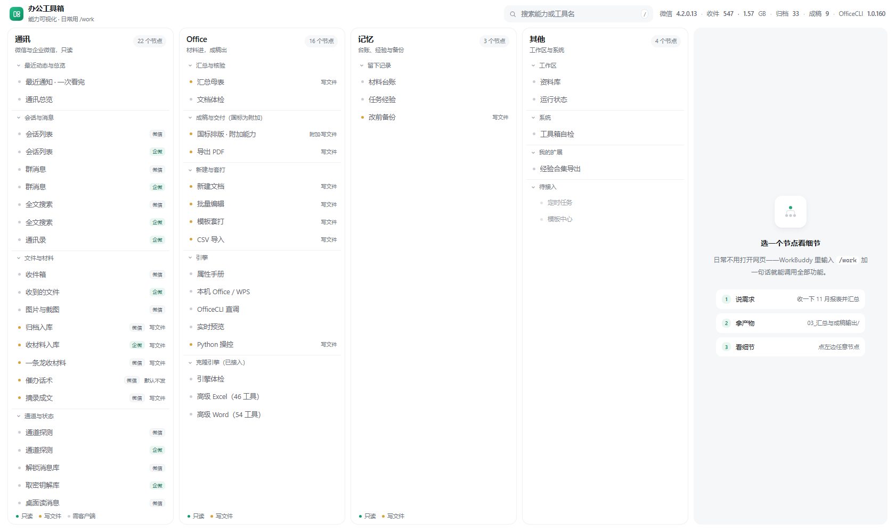

# 办公工具箱 · work-toolkit

> 把它当成给 WorkBuddy 装的**一个高级 Skill**：安装一次、重载会话，之后只记 `/work <一句话需求>`。
> **不用打开网页，不用手动信任 MCP**，47 个本地工具照样全部可用：跨微信 / 企业微信的**最近通知一次调用**、收件归档与催办、查群消息、图片解密、多科室跨表汇总核表、Office 批量处理与克隆引擎桥（高级 Excel / Word）、转 PDF、材料台账、轨迹驱动的任务经验配方与 Engram 通用记忆。GB/T 9704 国标公文保留为**按需附加能力**，不再是核心功能。工具按**通讯**与 **Office** 两个模块分开，可以各自升级、各自验收。
> 网页控制台保留为**可选的能力可视化展示**，不是使用前提。

全部功能在本机运行，不依赖云端服务，材料不出机器。



---

## 快速开始

```bat
git clone https://github.com/zGuanZhe/work-toolkit.git
cd work-toolkit
scripts\setup.cmd
```

看到 `✅ 准备完成` 后，**重载 WorkBuddy 会话，直接输入**：

```text
/work 通讯里最近有什么值得注意的通知
/work 把 11 月的报表收一下并合成汇总母表
/work 看看 XX 群最近说了什么
/work 安装          （新电脑 / 更新 / 依赖坏了）
/work 将本次工作整理为经验   （从真实工具调用轨迹生成可直接重放的配方）
```

`setup.cmd` 自动完成：挑解释器 → 补依赖 → 注册 MCP（可选增强）→ 生成网页（可选展示）→ 同步总 Skill → 跑工具、本地桥接与意图路由验收。
它只用标准库启动，哪怕系统里的 `python` 没装任何依赖也能自己修好。

| 想做什么 | 怎么做 |
|---|---|
| 日常办公 | WorkBuddy 里 `/work <需求>`，**唯一需要记的入口** |
| 看功能可视化 | 双击 `scripts\open-console.cmd`（可选） |
| 装到新电脑 / 更新 | `/work 安装` 或重跑 `scripts\setup.cmd` |
| 体检环境 | `/work 体检` |
| 改代码后验一遍 | `python tools\regress.py`（47 工具 + 本地桥接） |

> 详细步骤、手工安装、可选依赖与常见问题见 **[INSTALL.md](INSTALL.md)**。

---

## 它能做什么（由 `/work` 自动选，用户不用记工具名）

下面的表格是给维护者和好奇的人看的；日常只需说需求。总 Skill 第一步会执行
`work.py ask "<原话>"`，由 `web/intents.json` 把口语翻成确定的工具计划（含参数、是否写文件、
是否要先确认），再按计划调用——**所以不会时灵时不灵、不会猜错工具，也不会宣称工具里没有的能力**。
用户说「别写文件 / 只读」时，计划会自动过滤掉写产物工具。

### 1. 微信收件、催办与取证（只读优先）

| 工具 | 能力 |
| :--- | :--- |
| `work_wechat_probe` | 先探测本机通道：微信版本、SQLCipher+WAL 与 DPAPI 密钥缓存、本地收件目录、图片密钥是否可用 |
| `work_wechat_files` | **收件与归档统一入口**：`mode='scan'`（只读扫描统计）、`mode='pull'`（筛选复制+去重）、`mode='harvest'`（一键归档+联动底册与台账核对未交名单） |
| `work_wechat_remind` | @ 未交单位催办（默认 `dry_run=true`，失败落待发队列，不擅自发消息） |
| `work_wechat_sync` | **只读**：取 4.1.11+ 数据库密钥，解密到 `07_微信只读缓存/`，源库一律不改动 |
| `work_wechat_sessions` | **只读**：会话列表，群名 / 备注还原、未读数、最后摘要 |
| `work_wechat_messages` | **只读**：按会话读消息，`wxid` 映射为备注名，支持 `since` / `until` |
| `work_wechat_search` | **只读**：历史消息全文搜索，zstd 压缩长消息先解压再匹配 |
| `work_wechat_media` | **只读 + 导出**：解密 `msg/attach` 下的 `.dat`（AES-128-ECB + XOR），出缩略图或 WXGF 原图 |
| `work_wechat_digest` | **写文件**：把某群一段时间的消息摘录成 `.docx` / `.md`，按天分组、图片可解密嵌入 |

### 1.5 企业微信：同一套动作，另一套通道

企业微信用的是 **wxSQLite3**（AES-128-CBC 按 4096 字节一页独立加密、无 HMAC、无保留区），
和个人微信的 SQLCipher 完全是两套东西；密钥只在 `WXWork.exe` 进程内存里，客户端关着就读不了。
通道打通之后，会话、消息、搜索、通讯录、文件、收材料六件事跟微信那一列一一对应：

| 工具 | 能力 |
| :--- | :--- |
| `work_wecom_probe` | **只读**：客户端在不在跑、数据目录在哪、几个加密库、密钥缓存有没有 |
| `work_wecom_sync` | **只读**：从进程内存按 cipher 结构体定位密钥（+8 处），解明文副本到 `07_企业微信缓存/`，按源库 mtime 增量刷新 |
| `work_wecom_sessions` | **只读**：会话列表，`R:` 群聊 / `S:` 单聊，带未读数与最后时间 |
| `work_wecom_messages` | **只读**：按会话读消息，正文从 protobuf 逐层解出，文件消息带文件名 |
| `work_wecom_search` | **只读**：正文在 protobuf 里、SQL 搜不到，按时间窗取候选再逐条解正文匹配 |
| `work_wecom_contacts` | **只读**：通讯录（姓名 / 拼音 / 手机 / 邮箱 / 职位） |
| `work_wecom_files` | **只读**：收到的文件，含 `on_disk`（云端文件要在客户端点开才落地，未下载是真实状态） |
| `work_wecom_harvest` | **写文件**：按时间窗 / 群 / 扩展名复制到 `01_企业微信收回原件`，`{chat}` 前缀、按内容去重，默认 `dry_run=true` |
| `work_comms_overview` | **只读**：通讯总览，一次给微信 + 企业微信两条通道的状态，并把两边会话合成一条带通道标记的时间线（**不含消息正文**，别拿摘要硬答「有什么通知」） |
| `work_comms_notices` | **只读·通讯泛问首选**：一次调用扫两条通道最近 3 天的消息，默认通知在前、带截止时间的更前，正文裁短，给 `notice` / `due` / `time_ref` 召回标记与 `notice_by_chat`。取代「总览 → 逐会话读十几个群 → 全文搜索」的十几轮链路 |

### 2. Office 汇总、批量处理与转换（国标公文为附加能力）

| 工具 | 能力 |
| :--- | :--- |
| `work_office_consolidate` | 批量读 Word 申报表 + Excel 分表，合并成汇总母表，校验漏填 / 11 位手机号 / 分项与总计勾稽差额，输出《异常数据核验单》。**会写 xlsx，无 dry-run**；先看结构用只读的 `work_office_inspect` |
| `work_office_format_gbt9704` | **附加能力，非核心**：仅明确要求国标 / 红头 / 9704 时用。按 **GB/T 9704-2012** 排版 `.docx`：页边距 37/35/28/26 mm、二号小标宋标题、三号黑体/楷体/仿宋层级、固定 28 磅行距、四号页码 |
| `work_office_to_pdf` | 走本机 COM 导 PDF，版面与「另存为」一致；`engine=auto` 先试 Microsoft Office、失败自动换 **WPS** |
| `work_office_create` | **写文件**：从零建空白 `.docx` / `.xlsx` / `.pptx`（带 Word/Excel 默认样式），同名文件默认拒绝覆盖 |
| `work_office_batch` | **写文件**：一次提交多条操作（加段落、设格式、插表格、删元素），只开关文件一次；属性名先用 `work_office_schema` 查 |
| `work_office_merge` | **写文件**：模板 `{{key}}` + JSON 数据 → 一份新文档；一家一份就换 `output` 逐组调用 |
| `work_office_import` | **写文件**：把 CSV / TSV 导入已有 `.xlsx` 的指定工作表，可指定起始单元格、首行表头加筛选与冻结 |
| `work_office_schema` | **只读**：OfficeCLI 的 schema 参考（格式 → 元素 → 属性/单位/可选值），写 `--prop` 前先查 |
| `work_office_com` | **按动作**：直连本机 MS Office / WPS —— `apps` 看装了哪些、`info` 读页数字数、`export_pdf` 换引擎导 PDF、`recalc` 重算 Excel、`refresh_fields` 刷新 Word 域与目录、`replace` 查找替换、`read_cells` / `set_cells` 读写单元格 |
| `work_officecli_run` | OfficeCLI 单命令透传（`validate` / `get` / `query` / `set` / `add` / `batch` / `dump` / `raw-set` …） |
| `work_office_inspect` | `text` / `outline` / `stats` / `issues` / `annotated` / `forms` / `comments`（批注） / `screenshot`（高清截图 PNG） / `html` / `svg` / `pdf` / `skills`（10 套内置构建指南）十二种检视与渲染 |
| `work_office_compose` | **写文件（新增）**：Markdown（含 GFM 表格、` ```mermaid ` 流程图、`$$数学公式$$`）一键合成原生 `.docx` 或 `.pptx`，支持目录 `toc=true`、水印与 4 套排版预设 |
| `work_office_diff` | **只读/写报告（新增）**：对比两版 `.docx`（段落增删改+表格变化）或两张 `.xlsx`（单元格变动+数值增减差额 `delta`），可选导出 Markdown 差异报告 |
| `work_office_join_docx` | **写文件（新增）**：将目录或多份 `.docx` 合并汇编为一份完整 Word 文档，保留段落格式与表格 |
| `work_backup_file` | 任意文件都能单独备份，带时间戳另存到 `02_自动备份区/`，**绝不改源文件** |

### 2.5 克隆的 Office / MCP 引擎（真正接进调用链）

`mcp_servers/` 下的仓库不再是「克隆完就放着」：**先体检、再按需调用**，
`ready` 以真实 import 入口并数出工具数为准，路径存在不算可用。

| 工具 | 引擎 | 说明 |
| :--- | :--- | :--- |
| `work_office_engines` | 全部接入引擎 | 只读体检：逐个列 `ready` / `bridge` / `note`；真实探测 `excel-mcp-server`、`Office-Word-MCP-Server`、`OfficeMCP`、`bin/officecli.exe` 与 `wechat-chat-mcp` |
| `work_excel_mcp` | excel-mcp-server 2.2.9（46 个工具） | 离线高级 Excel：透视表、图表 / 切片器、条件格式、数据验证、公式追踪与目标求解、VBA 只读查看。`action=list` 列工具，`action=call` 调用；默认 `read_only=true`，写操作需 `allow_write=true` 且自动备份 |
| `work_word_mcp` | Office-Word-MCP-Server（58 个工具） | Word 高级能力：大纲 / XML 检视、批注、脚注尾注、文档保护、按锚点插入段落表格、页眉页脚；默认只放行 `get_/list_/find_/search_/view_` 前缀，写操作同样需显式授权 + 备份 |

**边界**：单张表改几个单元格、加公式、画图、透视，以及写报告 / 写通知，
仍走 WorkBuddy 原生表格与文档能力；这两个桥补的是原生能力覆盖不到、
或需要离线批量复现的高级操作。

### 3. 台账与自检

| 工具 | 能力 |
| :--- | :--- |
| `work_ledger` | 材料收发可追溯流水：`summary` / `departments` / `missing` / `history` / `batches` / `state` / `record`。按 sha256 去重，`seen_count` 是「扫到几次」，同科室多行才是「改了几版」 |
| `work_status` | 全部引擎就绪状态、工作区目录清单、最近一次收件 / 汇总 / 排版结果 |

### 4. 记忆模块：经验配方 + 通用记忆（`work_exp` / `work_mem`）

三层分工，互不替代：

| 层 | 工具 | 存什么 | 典型说法 |
| --- | --- | --- | --- |
| 流程配方 | `work_exp` | 一整段任务的**真实工具调用序列**（工具名、子工具、参数模板、踩坑） | 「将本次工作整理为经验」「搜经验 汇总」「按经验重放」「导出为 skill」 |
| 通用记忆 | `work_mem`（开源 [Engram](https://github.com/Gentleman-Programming/engram) v3.7.1） | 口径、偏好、决策、规律等跨会话事实，`topic_key` 同主题自动覆盖演进 | 「记住这个口径」「之前定过什么」「导出 obsidian」 |
| 材料台账 | `work_ledger` | 谁交了、交了几版、谁没交 | 「谁还没交」 |

`work_exp` 的 action：

| action | 干什么 |
| --- | --- |
| `distill` | **一句话生成经验**：读 `workspace/06_运行状态/tool_trace.jsonl`（每次 `work_*` 调用自动记录；缺失时回退读 Codex 会话里的 MCP 调用），区分有效步骤 / 探索调用 / 失败调用，参数抽成 `{{变量}}`，写出 9 段文档，含「精确工具清单」和「Agent 零探索直调配方」（提示词 + replay JSON + 命令行） |
| `search` | FTS5 按关键词 / 模块 / 工具名查经验 |
| `get` | 取整篇原文 |
| `replay` | 按文档里嵌入的流水线代入新变量重放；`dry_run=true` 只预览调用序列 |
| `to_skill` | 把高频流程导出成独立 Codex Skill |
| `trace` | 看最近的真实调用轨迹 |
| `save` / `template` / `export` / `list` | 手写保存（不给 content 时自动 distill）/ 空白骨架 / 合集 / 列目录 |

纪律：**不自动召回、不往上下文注入**——经验只在用户说「搜经验 / 按经验做」时才取；生成只在用户说「整理为经验」时才写。

> 设计取舍与旧版踩过的坑：[docs/EXPERIENCE.md](docs/EXPERIENCE.md)

---

## 用法：用户只用第一种

### ① 总 Skill + `/work`（推荐，也是默认）

安装后 WorkBuddy 里只多了一个「高级点的 Skill」和一个命令 `/work`。
不用打开网页，不用在连接器里点信任，agent 会通过 `scripts/work.py` 本地桥接直接调用工具：

```bash
python "<项目根目录>/scripts/work.py" call work_status "{}"
python "<项目根目录>/scripts/work.py" tools work_office_consolidate   # 不确定参数时查
```

Skill 负责把「一句话需求」翻译成工具与参数；用户不用知道有 47 个工具，也不用看 JSON。
安装、体检、经验文档、打开可视化网页也都用 `/work` 加一句话完成，不再有 `/exp`、`/exp-save`、`/work-setup` 等需要记的命令。

**它只接管「办公室批量流水」，不接管 WorkBuddy 的日常本事**：通讯（微信 + 企业微信）**最近通知聚合**、
收件与催办、多科室跨表汇总核表、Office 批量处理与引擎桥、材料台账、任务经验这几类是它的活；
国标公文只在明确点名时才用；写普通文档、做 PPT、读 PDF、改单张表、写代码、查资料，
照常用 WorkBuddy 原生能力。Skill 里有一节明确的边界表；`ask` 匹配不到时会返回
`scope: out_of_scope` 和 `native_suggestion`（该交给哪个原生能力），不是一句「找不到工具」，
所以不会硬把需求塞给 `work_*`，更不会因此让 WorkBuddy 少掉原有能力。

### 这一版补上的能力

| 能力 | 入口 | 说明 |
| --- | --- | --- |
| **实时预览** | `work_office_watch` | 起本地预览页，之后每次改动自动刷新；`goto` 让页面滚到某一段 |
| **Python 操控** | `work_office_com action="run_python"` | 注入 `Officer.Word/.Excel/.PPT` 执行脚本，干「按我说的把这一页排一下」这类活 |
| **接管当前窗口** | `action="active"` + `Officer.*` | 优先附加到用户已打开的实例，改完抬头就看见，不是后台偷偷改文件 |
| **WPS 双引擎** | `engine=ms/wps/auto` | Word↔KWPS、Excel↔KET、PPT↔KWPP，只装 WPS 的机器也能出报送件 |
| **OfficeCLI 全命令面** | `work_officecli_run` | 白名单 27 条子命令，补齐 `create`/`merge`/`import`/`batch`/`dump`/`schema`/`plugins`/`install`/`watch` |
| **薄入口 Skill** | `skills/work-office-toolkit/` | 常驻部分 10.1 KB（细节拆成 6 份 `references/` 按需读，四个模块各一份；常驻只留入口、边界与口径） |
| **通讯最近通知一次调用** | `work_comms_notices` | 两通道合并消息级时间线，通知优先排序 + 截止时间线索，泛问不再拼十几轮；CLI 直调走轻量注册器，省掉每次约 0.9 s 的 MCP 框架导入 |
| **克隆引擎真正接入** | `work_office_engines` / `work_excel_mcp` / `work_word_mcp` | 46 + 58 个高级 Excel / Word 工具进程内可调用，默认只读、写前自动备份；`ready` 以真实加载为准 |

> 维护者若想改网页节点/样式，另有一个 `work-console-upgrade` Skill；日常办公完全不需要它。

### ② 网页控制台（可选的能力可视化）

`web/console.html` 是**单文件、无外链、无 CDN、无字体**的页面，四列节点（白底、圆角、无细线尖角，顶栏可按名字搜节点）：

| 列 | 节点举例 |
|---|---|
| **通讯** | 微信与企业微信合成一列：**最近通知（首屏首选）**、通讯总览（两通道状态 + 合并时间线）、会话列表、群消息、全文搜索、收件箱 / 收到的文件、通讯录、图片与截图、归档入库 / 收材料入库、一条龙收材料、催办话术、摘录成文、通道探测、取密钥解库 |
| **Office** | 汇总母表、文档体检、改前备份、导出 PDF、**国标排版（附加能力）**、新建文档、批量编辑、模板套打、CSV 导入、属性手册、本机 Office / WPS、OfficeCLI 直调、实时预览、Python 操控、**克隆引擎体检 / 高级 Excel / 高级 Word** |
| **记忆** | 材料台账、**任务经验**（整篇复制）、改前备份 |
| **其他** | 工作区目录树、运行状态、工具箱自检、自定义节点 |

点节点 → 右栏给出「一句话简介 → 复制提示词 / 直接调用 → 做什么 → 数据区 → 输入输出与底层工具」。
**静态双击**只能浏览；用 `scripts\open-console.cmd` 起本地服务后「直接调用」才真的执行工具（`/api/*` 接口）。
网页只是展示层；关掉它，`/work` 的全部功能照常可用。

自定义功能不用改 HTML：编辑 `web/custom_nodes.json`，`python tools\check_nodes.py` 会在构建期查出 id 撞车、工具名写错、字段缺失。

### ③ MCP 服务（可选增强 / 其他客户端）

`mcp/work_toolkit_server.py` 是 stdio MCP 服务，配到任意客户端即可：

```json
{
  "mcpServers": {
    "work-toolkit": {
      "command": "<装齐依赖的 python.exe 绝对路径>",
      "args": ["<项目根目录>/mcp/work_toolkit_server.py"],
      "env": { "PYTHONIOENCODING": "utf-8", "PYTHONUTF8": "1" }
    }
  }
}
```

`python tools\register_mcp.py` 自动写这份配置（合并保留其他 MCP）。**这是可选增强**：其他 MCP 客户端、或想让工具列表里直接出现 `work_*` 时才用；WorkBuddy 日常 `/work` 走本地桥接，不点「信任」也完全可用。

只要一个模块的话，换成各自的入口即可：`mcp/work_comms_server.py`（其他 + 通讯，25 个）、
`mcp/work_office_server.py`（其他 + Office，20 个）或 `mcp/work_memory_server.py`（其他 + 记忆，6 个），
不需要的依赖根本不会加载。

---

## 模块化：通讯 / Office / 记忆 / 其他，各改各的

```
mcp/work_core.py               内核：注册器、路径常量、参数说明（不放业务工具）
mcp/work_mods/comms.py         通讯：微信 + 企业微信只读（23 个）
mcp/work_mods/office.py        Office：通用富文档与PPT合成 / 版本对比 / 多文档合并 / 无模板汇总 / 排版 / OfficeCLI / COM / 高级 Excel 与 Word（18 个）
mcp/work_mods/memory.py        记忆：经验配方 work_exp / Engram 通用记忆 work_mem / 材料台账 / 文件备份（4 个）
mcp/work_mods/other.py         其他：状态总览 / 模块清单（2 个，公共底座随各入口挂载）
mcp/work_toolkit_server.py     合体入口：只挂载四个 ToolBox，自身不实现工具（47 个）
mcp/work_comms_server.py       通讯入口：其他 + 通讯（25 个）
mcp/work_office_server.py      Office 入口：其他 + Office（20 个）
mcp/work_memory_server.py      记忆入口：其他 + 记忆（6 个）
```

- 通讯 / Office / 记忆三个业务模块**互不 import**：改通讯不用打开 `office.py`，
  改 Office 也不用读 `comms.py`，台账与经验只在 `memory.py` 里动。
- 通讯入口不需要 Office 依赖；Office 入口不需要微信客户端开着；记忆入口只读写本地台账 / 经验 md / Engram 库 / 备份。
- 「其他」是公共底座（状态总览、模块清单）：每个入口都会挂上它，改它要跑全量回归。
- 查归属：`/work` 的 `work.py modules`（或 `work_modules` 工具），只看某模块工具：`work.py tools --module comms`。
- 分别验收：`python tools\regress.py --module comms` / `--module office` / `--module memory`
  （其他用例每个模块都会带上）；不带 `--module` 跑全量。

---

## 目录结构

```
mcp/work_core.py               内核（注册器 / 路径 / 参数说明）
mcp/work_mods/                 通讯 comms.py、Office office.py、记忆 memory.py、其他 other.py（互不 import）
mcp/work_toolkit_server.py     合体入口：挂载四个模块（46 个工具；CLI 直调走轻量注册器）
mcp/work_comms_server.py       通讯模块入口（其他 + 通讯，25 个）
mcp/work_office_server.py      Office 模块入口（其他 + Office，20 个）
mcp/work_memory_server.py      记忆模块入口（其他 + 记忆，6 个）
mcp_servers/                  克隆的 Office / 通讯 MCP 仓库（excel-mcp、Word MCP 已接入调用链）
mcp/dump_tools.py             由函数签名生成 web/tools.json（带 module 归属）
experience/library.py         任务经验文档库（纯标准库、零依赖）
web/                          模板 / 构建 / 本地服务 / 自定义节点
  _console_template.html      页面模板（改这里）
  build.py                    生成 console.html（构建产物不进仓库）
  serve.py                    /api/* 本地服务
  custom_nodes.json           用户自定义节点
  intents.json                /work 第一步的意图路由表（口语 → 确定的工具计划）
  tools.json                 由 dump_tools.py 生成的工具清单
tools/                        doctor / regress（支持 --module）/ check_nodes / check_intents / register_mcp / run_tool
scripts/                      setup / work.py（本地桥接）/ launch / install_skills / .cmd 入口
skills/                       薄入口 Skill + references/ 按需读 + 唯一 /work 命令；另有维护者用的网页升级 Skill
workspace/11_任务经验/         两篇真实任务样板 + index.md
docs/                         EXPERIENCE / INTEGRATION / WECHAT-CAPABILITY
```

**仓库刻意不含**：微信聊天数据库与解密密钥、图片缓存、材料原件、测试产物、`console.html`（内嵌本机环境快照）、`mcp_servers/`（本地挂载的上游 MCP 项目）。这些留在本机，见 `.gitignore` 与 INSTALL.md。

`bin/officecli.exe` 随仓库附带以便开箱即用，但它是**第三方组件**，不在本项目的 MIT 许可范围内，详见 [bin/README.md](bin/README.md)。

---

## 能力边界与隐私

- **全部本机运行**，不调用任何云端 API，不上传材料。微信相关能力以只读为主；写操作只往 `workspace/` 落文件。
- 微信 4.x 的桌面 UI 自动化在本机不可用（客户端在托盘、无主窗口），因此**不提供未经验证的发送能力**；催办默认只生成话术，失败落待发队列。
- `work_officecli_run` / `work_office_inspect` 依赖 `bin/officecli.exe`（已随仓库附带）；`work_office_to_pdf` 需要本机装有 Microsoft Office。缺 Office 时对应工具会明确报错，不影响其余工具。
- 目前只在 **Windows + Python 3.10+（实测 3.14.4）** 上验证过；微信解密链路针对 4.x，企业微信解密链路针对 wxSQLite3 加密库（需客户端在运行）。

---

## 验收基线（本机实测）

| 项目 | 结果 |
| --- | --- |
| 工具回归 | `tools/regress.py` 65 条用例 / 37 工具 / **0 失败** |
| 前端 | 3 列 41 节点，Edge 无头实测渲染正常；内联脚本 `node --check` 通过 |
| 经验库 | `list` 与 `get` 毫秒级，整篇原文不截断；同名同日期 `save` 默认不覆盖 |
| 网页产物 | `console.html` 约 **134 KB 单文件**，无外链 |
| 仓库体积 | 源码与文档约 **1 MB** + OfficeCLI 二进制 32 MB |
| 一键安装 | `setup.cmd` 6 步，工具与桥接验收 **8/8** 通过 |

---

## 许可

本项目自编的代码与文档采用 [MIT](LICENSE)。
随仓库附带的 `bin/officecli.exe` 是第三方组件，**不在 MIT 授权范围内**，见 [bin/README.md](bin/README.md)。

---

## 文档

| 文档 | 内容 |
| --- | --- |
| [INSTALL.md](INSTALL.md) | 安装、MCP 接入、可选依赖、验证与常见问题 |
| [docs/EXPERIENCE.md](docs/EXPERIENCE.md) | 任务经验库的设计取舍、骨架、旧版踩过的坑 |
| [docs/INTEGRATION-WorkBuddy.md](docs/INTEGRATION-WorkBuddy.md) | 架构、工具清单、接口、验收数据与能力边界 |
| [docs/WECHAT-CAPABILITY.md](docs/WECHAT-CAPABILITY.md) | 微信 4.x 通道原理与解密链路（含企业微信 wxSQLite3 一节） |
